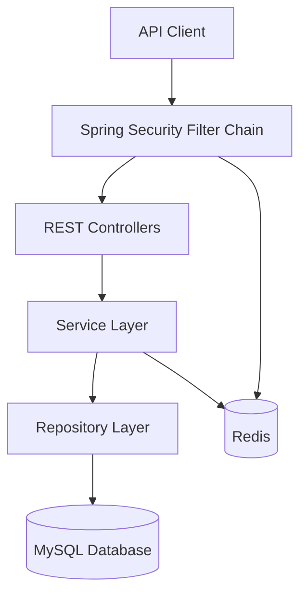
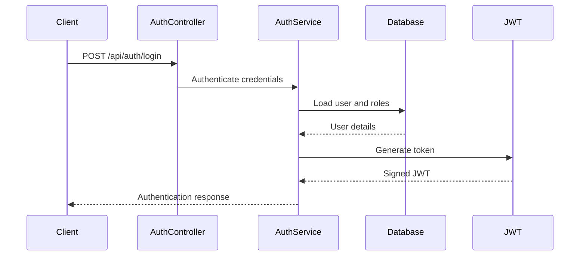
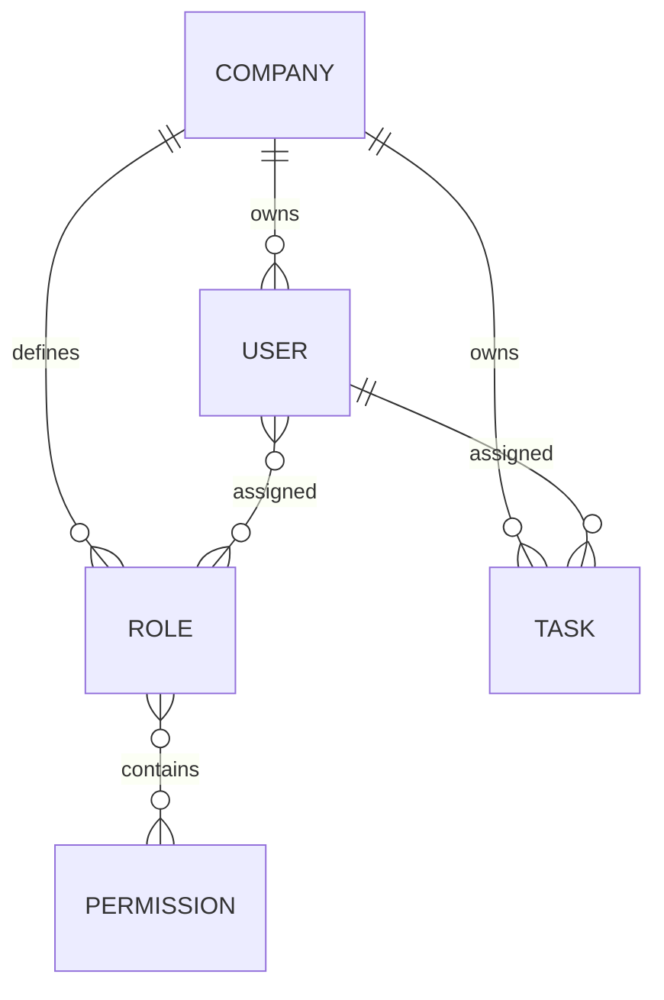
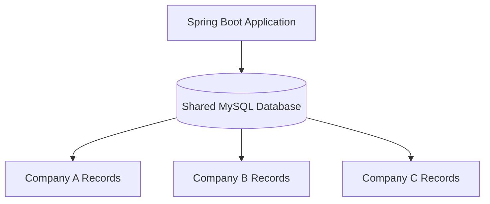

# Architecture

## 1. Overview

Enterprise Platform currently follows a layered monolithic backend architecture built with Spring Boot.

The application separates API handling, business logic, persistence, domain models and security infrastructure.

## 2. High-Level Architecture

## 3. Application Layers

### Controller Layer

Handles incoming HTTP requests, request validation and response generation.

Controllers:
- AuthController
- PlatformCompanyController
- TenantUserController
- TenantRoleController
- TenantTaskController

### Service Layer

Contains application business logic.

Services:
- AuthService
- CompanyService
- UserService
- RoleService
- TaskService

### Repository Layer

Uses Spring Data JPA to access MySQL.

Repositories:
- CompanyRepository
- UserRepository
- RoleRepository
- TaskRepository

### Domain Layer

Contains the primary business entities:

- Company
- User
- Role
- Task

Application permissions, task status and task priority are represented using enums.

## 4. Authentication Flow

Subsequent authenticated requests pass through the JWT authentication filter.

The security infrastructure also includes account-state validation, password-change enforcement and token revocation checks.

## 5. Authorization Model

The platform uses Role-Based Access Control (RBAC).

A company can have multiple users and roles. Roles contain permissions, and users can be assigned roles.

Permissions are represented by the `AppPermission` enum.

Tenant controller methods use Spring Security method-level authorization with `@PreAuthorize`.

## 6. Current Multi-Tenancy Design

The current implementation uses a shared-schema model.

Tenant-owned records reference a company through `company_id`.

Tenant-specific repository operations use the authenticated user's company identifier to scope data access.

This is application-level tenant isolation within a shared schema. It is not schema-per-tenant isolation.

## 7. Redis Infrastructure

Redis is currently used for:

- JWT token revocation and session blocklisting.
- Tenant-level API rate limiting.

The rate-limiting implementation uses Redis Lua operations.

## 8. Security Considerations

The current implementation is under active development.

Known limitations include:

- Platform company-management endpoints require dedicated permission-level authorization.
- Initial account provisioning uses a common default password.
- Redis revocation failure handling needs improvement.
- Additional cross-tenant and privilege-escalation integration tests are required.

## 9. Planned Architecture Evolution

The next major architectural upgrade is schema-per-tenant isolation.

The planned design will introduce:

- Tenant discovery and identification.
- Tenant-specific schema routing.
- Automated tenant schema provisioning.
- Flyway-based schema migrations.
- Tenant lifecycle management.

These capabilities are planned and are not part of the current implementation.
